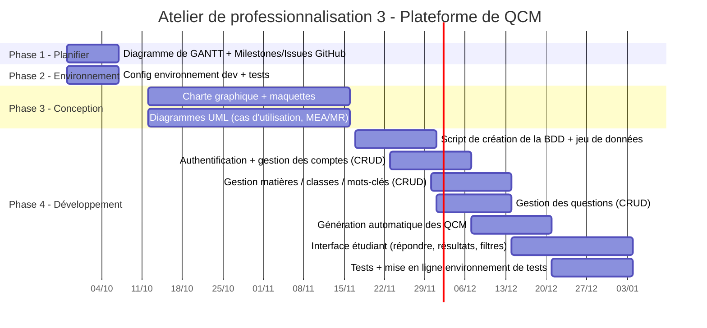

# Planification du projet

------

**Date de création** : 19/11/2026
**Date de modification** : 19/11/2026
**Sommaire :**

> [TOC]

## 1. Diagramme de GANTT

## 2. Étapes et tâches dans GitHub

Les étapes ci-dessus sont transcrites en **Milestones** GitHub, et chaque ligne du diagramme correspond à une ou plusieurs **Issues** (tickets), assignées à un membre de l'équipe.

### Milestones

| Milestone | Échéance |
|---|---|
| Rendu 1 - Planifier le projet | 07/10/2026 |
| Rendu 2 - Organiser l'environnement de travail | 07/10/2026 |
| Rendu 3 - Concevoir l'application | 16/11/2026 |
| Rendu 4 - Développer l'application | 04/01/2027 |

### Issues (tickets)

**Rendu 1 - Planifier**
- [x] Définir le diagramme de GANTT du projet
- [x] Créer les Milestones dans GitHub
- [x] Créer les Issues correspondant aux tâches
- [x] Rédiger docs/projet/planification.md

**Rendu 2 - Environnement**
- [x] Choisir et configurer l'environnement de dev (VM / WSL / Multipass)
- [x] Installer Apache, PHP, MariaDB
- [x] Configurer l'environnement de tests
- [x] Rédiger docs/technique/installations.md

**Rendu 3 - Conception**
- [ ] Charte graphique + maquettes des écrans
- [ ] Diagramme de contexte statique
- [ ] Diagramme de cas d'utilisation
- [ ] Modèle entité-association / modèle relationnel
- [ ] Rédiger docs/technique/architecture.md

**Rendu 4 - Développement**
- [ ] Script SQL de création de la BDD + jeu de données de test
- [ ] feature/authentification (AuthMiddleware, connexion/déconnexion)
- [ ] feature/gestion-comptes (CRUD utilisateurs, rôles)
- [ ] feature/gestion-matieres (CRUD matières)
- [ ] feature/gestion-classes (CRUD classes)
- [ ] feature/gestion-motscles (CRUD mots-clés)
- [ ] feature/gestion-questions (CRUD questions)
- [ ] feature/generation-qcm (génération automatique par mots-clés)
- [ ] feature/espace-etudiant (liste QCM, réponse, résultats, filtres)
- [ ] Tests + mise en ligne sur l'environnement de tests

## 3. Capture d'écran des tâches et étapes dans GitHub

