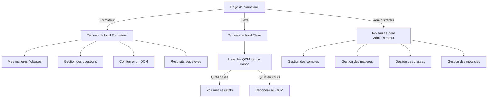
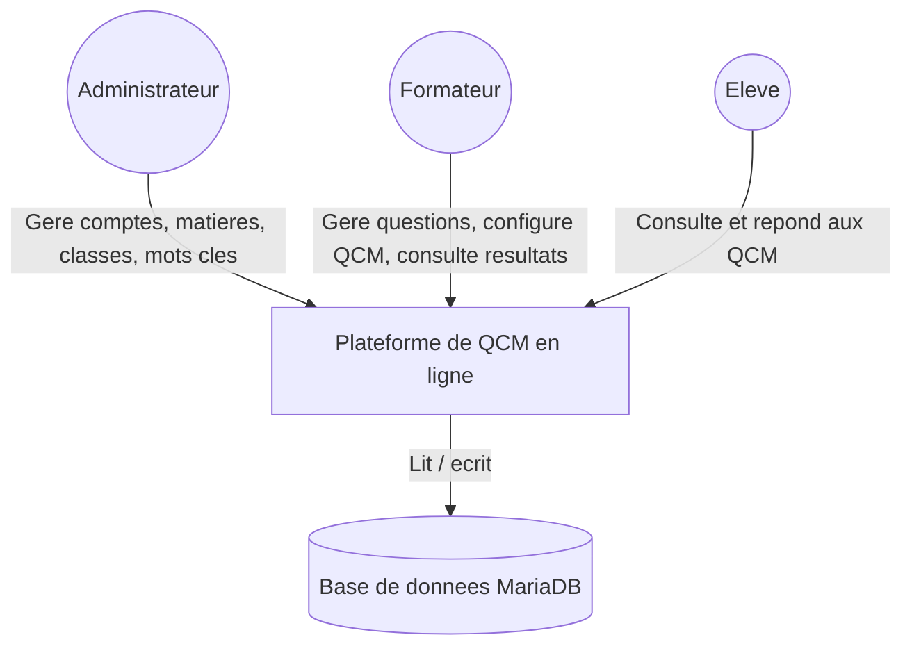
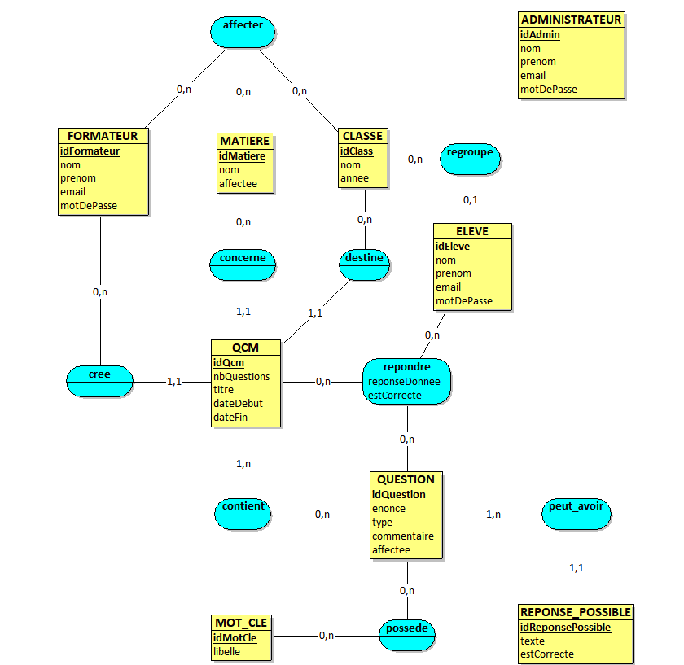

# Étude technique - Conception de l'application

------

**Date de création** : 23/11/2026
**Date de modification** : 24/11/2026
**Sommaire :**

> [TOC]

<div style="page-break-after:always"></div>

## 1. Charte graphique

### 1.1. Identité visuelle

| Élément | Choix |
|---|---|
| Couleur principale | Bleu `#2563EB` (actions, liens, boutons) |
| Couleur secondaire | Gris `#64748B` (texte secondaire, bordures) |
| Couleur succès | Vert `#16A34A` (bonne réponse, validation) |
| Couleur erreur | Rouge `#DC2626` (mauvaise réponse, suppression) |
| Police | Système (Segoe UI / Arial) |
| Style | Interface sobre, orientée formulaire et tableaux |

### 1.2. Logique de navigation



### 1.3. Maquettes des écrans

*(wireframes conservés tels quels, voir version précédente / Medias/)*

<div style="page-break-after:always"></div>

## 2. Diagramme de contexte statique



<div style="page-break-after:always"></div>

## 3. Diagramme de cas d'utilisation

*(inchangé, voir version précédente)*

<div style="page-break-after:always"></div>

## 4. Modèle conceptuel de données (MCD)

Entités : `FORMATEUR`, `ELEVE`, `ADMINISTRATEUR`, `CLASSE`, `MATIERE`, `QCM`, `QUESTION`, `REPONSE_POSSIBLE`, `MOT_CLE`.

Associations :

| Association | Entités liées | Cardinalités |
|---|---|---|
| affecter (ternaire) | FORMATEUR ↔ MATIERE ↔ CLASSE | FORMATEUR (0,n) — MATIERE (0,n) — CLASSE (0,n) |
| regroupe | CLASSE ↔ ELEVE | CLASSE (0,n) — ELEVE (0,1) |
| concerne | MATIERE ↔ QCM | MATIERE (0,n) — QCM (1,1) |
| destine | CLASSE ↔ QCM | CLASSE (0,n) — QCM (1,1) |
| cree | FORMATEUR ↔ QCM | FORMATEUR (0,n) — QCM (1,1) |
| contient | QCM ↔ QUESTION | QCM (1,n) — QUESTION (0,n) |
| repondre (ternaire, porte reponseDonnee + estCorrecte) | ELEVE ↔ QCM ↔ QUESTION | ELEVE (0,n) — QCM (0,n) — QUESTION (0,n) |
| possede | QUESTION ↔ MOT_CLE | QUESTION (0,n) — MOT_CLE (0,n) |
| peut_avoir | QUESTION ↔ REPONSE_POSSIBLE | QUESTION (1,1) — REPONSE_POSSIBLE (0,n) |

`ADMINISTRATEUR` n'est relié à aucune autre entité : ses actions (gestion des comptes/matières/classes/mots-clés) sont des traitements applicatifs (CRUD), pas des données à relier structurellement.



<div style="page-break-after:always"></div>

## 5. Modèle logique / relationnel (MLD)

```
FORMATEUR (idFormateur, nom, prenom, email, motDePasse)

ELEVE (idEleve, nom, prenom, email, motDePasse, #idClass)

ADMINISTRATEUR (idAdministrateur, nom, prenom, email, motDePasse)

CLASSE (idClass, nom, annee)

MATIERE (idMatiere, nom, affectee)

AFFECTATION (idAffectation, #idFormateur, #idMatiere, #idClass)

QCM (idQcm, titre, nbQuestions, dateDebut, dateFin, #idMatiere, #idClass, #idFormateur)

QUESTION (idQuestion, enonce, type, commentaire, affectee)

QCM_QUESTION (#idQcm, #idQuestion)

REPONSE_POSSIBLE (idReponsePossible, texte, estCorrecte, #idQuestion)

MOT_CLE (idMotCle, libelle)

QUESTION_MOT_CLE (#idQuestion, #idMotCle)

REPONSE_ELEVE (idReponseEleve, reponseDonnee, estCorrecte, #idEleve, #idQcm, #idQuestion)
```

*(`#` = clé étrangère)*

**Règles de gestion :**
- `affecter` (ternaire sans attribut propre) devient la table de jonction `AFFECTATION` avec ses 3 clés étrangères.
- `repondre` (ternaire avec attributs) devient la table `REPONSE_ELEVE`, avec ses 3 clés étrangères + ses propres colonnes.
- `contient` et `possede` (many-to-many) deviennent des tables de jonction simples.
- `peut_avoir`, `concerne`, `destine`, `cree`, `regroupe` (1,n) : la clé étrangère se place du côté de l'entité dont la cardinalité max vaut 1 (`REPONSE_POSSIBLE`, `QCM`, `ELEVE` respectivement).
- Une matière/question/mot-clé déjà `affectee`/utilisée ne peut plus être modifiée (contrôle applicatif).

<div style="page-break-after:always"></div>

## 6. Architecture des répertoires du projet

*(inchangée, voir version précédente — points de sécurité : seul `public/` exposé, `.env` hors versionnement, mots de passe hachés avec `password_hash()`, contrôle des rôles via Middleware)*
