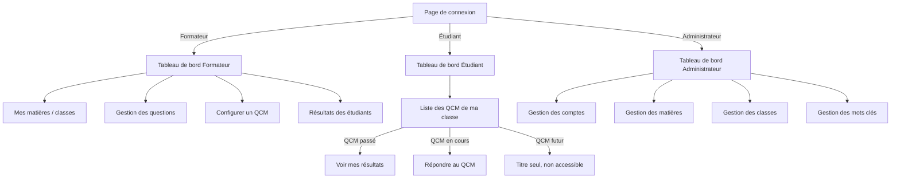
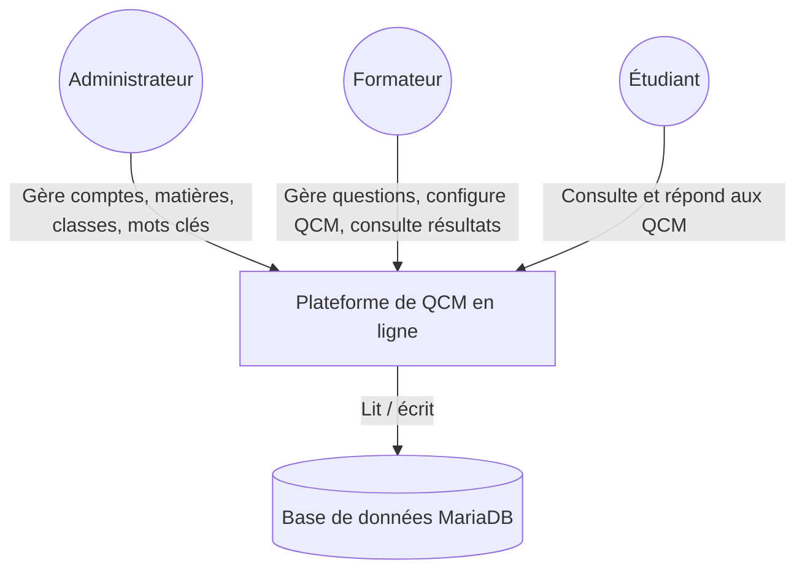
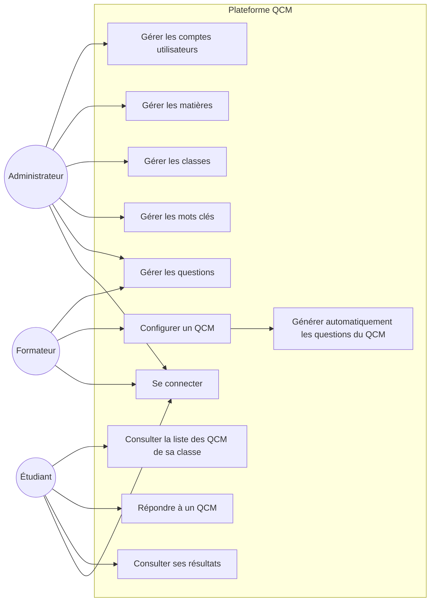
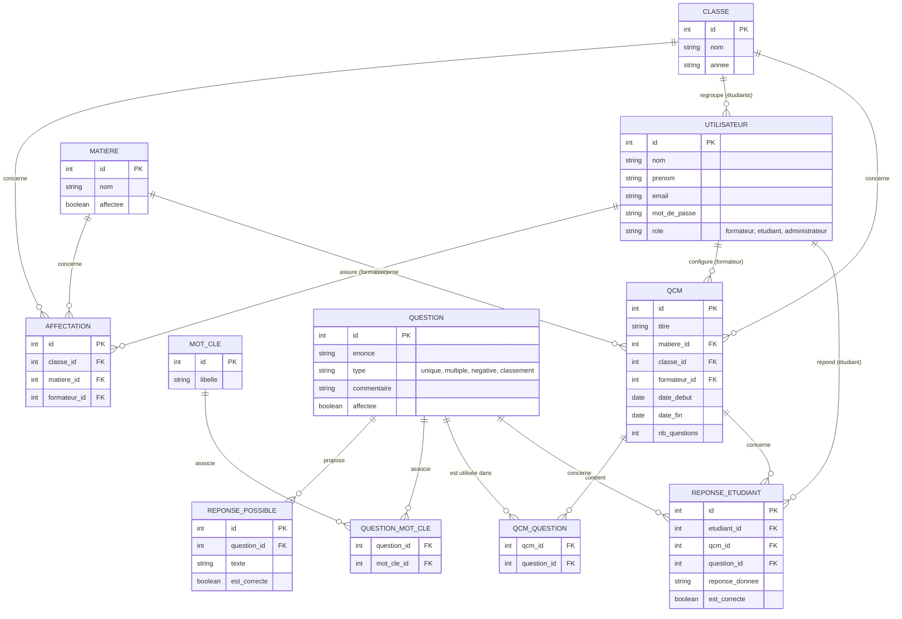

# Étude technique - Conception de l'application

------

**Date de création** : 23/11/2026
**Date de modification** : 23/11/2026
**Sommaire :**

> [TOC]

<div style="page-break-after:always"></div>

## 1. Charte graphique

### 1.1. Identité visuelle

| Élément | Choix |
|---|---|
| Couleur principale | Bleu `#2563EB` (actions, liens, boutons) |
| Couleur secondaire | Gris `#64748B` (texte secondaire, bordures) |
| Couleur succès | Vert `#16A34A` (bonne réponse, validation) |
| Couleur erreur | Rouge `#DC2626` (mauvaise réponse, suppression) |
| Police | Système (Segoe UI / Arial) pour la lisibilité sur tous les postes |
| Style | Interface sobre, orientée formulaire et tableaux (peu d'illustrations, priorité à la lisibilité des QCM) |

### 1.2. Logique de navigation



### 1.3. Maquettes des écrans (wireframes)

**Écran de connexion**
```
┌──────────────────────────────┐
│   Plateforme QCM              │
│                                │
│   Email      [______________] │
│   Mot de passe [____________] │
│                                │
│          [ Se connecter ]      │
└──────────────────────────────┘
```

**Tableau de bord Étudiant (liste des QCM)**
```
┌───────────────────────────────────────────┐
│  Mes QCM - Classe BTS SIO2                 │
│  Filtres : [Matière ▾] [Date ▾]            │
│ ─────────────────────────────────────────  │
│  Mathématiques - QCM n°3   (à venir)        │
│  Anglais - QCM n°2         [Répondre]       │
│  PHP - QCM n°1             [Voir résultat]  │
└───────────────────────────────────────────┘
```

**Tableau de bord Formateur (configurer un QCM)**
```
┌───────────────────────────────────────────┐
│  Nouveau QCM                                │
│  Titre          [_________________]         │
│  Matière        [Choisir ▾]                 │
│  Classe         [Choisir ▾]                 │
│  Nb questions   [___]                       │
│  Mots clés      [x] Boucles [x] Fonctions   │
│  Date début     [__/__/____]                │
│  Date fin       [__/__/____]                │
│                     [ Générer le QCM ]      │
└───────────────────────────────────────────┘
```

**Administration des comptes**
```
┌───────────────────────────────────────────┐
│  Comptes utilisateurs          [+ Ajouter]  │
│ ─────────────────────────────────────────  │
│  Nom         Rôle        Actions            │
│  Dupont J.   Formateur   [Modifier][Suppr.] │
│  Martin L.   Étudiant    [Modifier][Suppr.] │
└───────────────────────────────────────────┘
```

<div style="page-break-after:always"></div>

## 2. Diagramme de contexte statique



**Acteurs principaux** : Administrateur, Formateur, Étudiant.
**Acteur secondaire** : le Système (génération automatique des QCM à partir des mots clés).

<div style="page-break-after:always"></div>

## 3. Diagramme de cas d'utilisation



### Description textuelle - cas d'utilisation « Répondre à un QCM »

- **Acteur** : Étudiant
- **Préconditions** : l'étudiant est connecté, le QCM est dans l'intervalle de dates prévu, l'étudiant n'a pas déjà validé ce QCM.
- **Scénario nominal** :
    1. L'étudiant sélectionne un QCM « en cours » dans sa liste.
    2. Le système affiche les questions associées au QCM.
    3. L'étudiant répond à chaque question.
    4. L'étudiant valide le QCM.
    5. Le système enregistre les réponses et calcule le résultat.
- **Enchaînement alternatif** : l'étudiant quitte sans valider → ses réponses ne sont pas enregistrées, le QCM reste accessible en « à faire ».
- **Postconditions** : le QCM est marqué comme validé pour cet étudiant, il peut uniquement en consulter le résultat.

### Description textuelle - cas d'utilisation « Configurer un QCM »

- **Acteur** : Formateur
- **Préconditions** : le formateur est connecté et associé à au moins une matière/classe.
- **Scénario nominal** :
    1. Le formateur crée un QCM (titre, matière, classe, dates).
    2. Il indique le nombre de questions souhaité et les mots clés thématiques.
    3. Le système sélectionne aléatoirement les questions correspondantes parmi celles disponibles.
    4. Le système enregistre l'association QCM-questions.
- **Enchaînement d'erreur** : nombre de questions disponibles insuffisant pour les mots clés choisis → le système affiche un message d'erreur et ne crée pas le QCM.
- **Postconditions** : le QCM est créé et visible par les étudiants de la classe concernée dès sa date de début.

<div style="page-break-after:always"></div>

## 4. Modèle entité-association (MEA)



## 5. Modèle relationnel

```
UTILISATEUR (id, nom, prenom, email, mot_de_passe, role)

CLASSE (id, nom, annee)

MATIERE (id, nom, affectee)

AFFECTATION (id, #classe_id, #matiere_id, #formateur_id)

MOT_CLE (id, libelle)

QUESTION (id, enonce, type, commentaire, affectee)

REPONSE_POSSIBLE (id, #question_id, texte, est_correcte)

QUESTION_MOT_CLE (#question_id, #mot_cle_id)

QCM (id, titre, #matiere_id, #classe_id, #formateur_id, date_debut, date_fin, nb_questions)

QCM_QUESTION (#qcm_id, #question_id)

REPONSE_ETUDIANT (id, #etudiant_id, #qcm_id, #question_id, reponse_donnee, est_correcte)
```

*(`#` = clé étrangère)*

**Règles de gestion traduites dans le modèle :**
- Une matière affectée (`affectee = true`) ne peut plus être modifiée/supprimée (contrôle applicatif).
- Une question affectée à un QCM (`affectee = true`) ne peut plus être modifiée, uniquement dupliquée (contrôle applicatif).
- Un mot clé utilisé par au moins une question (présence dans `QUESTION_MOT_CLE`) ne peut plus être modifié/supprimé.
- L'association QCM ↔ questions est figée après génération aléatoire (table `QCM_QUESTION`), garantissant la traçabilité du QCM passé par un étudiant.

<div style="page-break-after:always"></div>

## 6. Architecture des répertoires du projet

```
monProjet/
├── app/            # Code applicatif (MVC) : Controllers, Models, Views, Middleware, Security, Core
├── public/         # SEUL dossier exposé publiquement par Apache (DocumentRoot)
├── uploads/        # Fichiers déposés par les utilisateurs (hors de public/, non exécutable)
├── storage/        # Logs, cache (hors de public/)
├── config/         # Fichiers de configuration (hors de public/)
├── docs/           # Documentation du projet
├── tests/          # Tests unitaires
├── vendor/         # Dépendances Composer (généré, non versionné)
├── .env            # Identifiants réels (non versionné)
└── env.example     # Modèle de .env (versionné, sans valeurs sensibles)
```

**Points de sécurité pris en compte :**
- Seul `public/` est accessible depuis le web : le code métier, la configuration et les fichiers uploadés ne sont jamais exécutables ou listables directement par URL.
- Les identifiants de connexion à la base de données sont externalisés dans `.env`, exclu du suivi de version.
- Les mots de passe des comptes utilisateurs seront stockés hachés (`password_hash()` en PHP), jamais en clair.
- Les droits d'accès aux fonctionnalités (CRUD matières, comptes, etc.) sont contrôlés par le rôle de l'utilisateur via le `Middleware` d'autorisation, à chaque requête.
- Une question ou un mot clé déjà utilisé est protégé contre la modification/suppression au niveau applicatif, pour garantir l'intégrité des QCM déjà passés par des étudiants.
