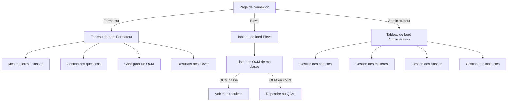
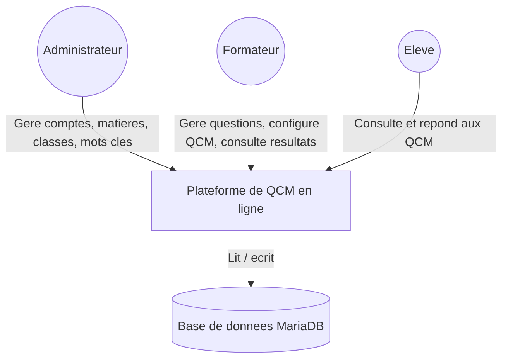
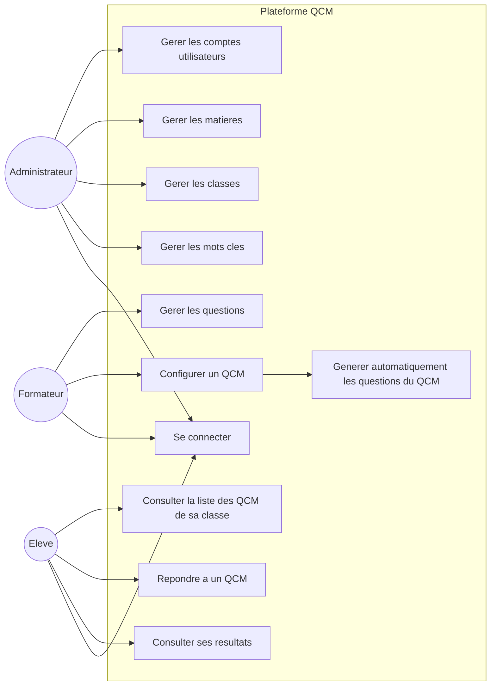

# Étude technique - Conception de l'application

------

**Date de création** : 23/11/2026
**Date de modification** : 24/11/2026
**Sommaire :**

> [TOC]

<div style="page-break-after:always"></div>

## 1. Charte graphique

### 1.1. Identité visuelle

| Élément | Choix |
|---|---|
| Couleur principale | Bleu `#2563EB` (actions, liens, boutons) |
| Couleur secondaire | Gris `#64748B` (texte secondaire, bordures) |
| Couleur succès | Vert `#16A34A` (bonne réponse, validation) |
| Couleur erreur | Rouge `#DC2626` (mauvaise réponse, suppression) |
| Police | Système (Segoe UI / Arial) |
| Style | Interface sobre, orientée formulaire et tableaux |

### 1.2. Logique de navigation



### 1.3. Maquettes des écrans (wireframes)

**Écran de connexion**
```
┌──────────────────────────────┐
│   Plateforme QCM              │
│                                │
│   Email      [______________] │
│   Mot de passe [____________] │
│                                │
│          [ Se connecter ]      │
└──────────────────────────────┘
```

**Tableau de bord Élève (liste des QCM)**
```
┌───────────────────────────────────────────┐
│  Mes QCM - Classe BTS SIO2                 │
│  Filtres : [Matière ▾] [Date ▾]            │
│ ─────────────────────────────────────────  │
│  Mathématiques - QCM n°3   (à venir)        │
│  Anglais - QCM n°2         [Répondre]       │
│  PHP - QCM n°1             [Voir résultat]  │
└───────────────────────────────────────────┘
```

**Tableau de bord Formateur (configurer un QCM)**
```
┌───────────────────────────────────────────┐
│  Nouveau QCM                                │
│  Titre          [_________________]         │
│  Matière        [Choisir ▾]                 │
│  Classe         [Choisir ▾]                 │
│  Nb questions   [___]                       │
│  Mots clés      [x] Boucles [x] Fonctions   │
│  Date début     [__/__/____]                │
│  Date fin       [__/__/____]                │
│                     [ Générer le QCM ]      │
└───────────────────────────────────────────┘
```

**Administration des comptes**
```
┌───────────────────────────────────────────┐
│  Comptes utilisateurs          [+ Ajouter]  │
│ ─────────────────────────────────────────  │
│  Nom         Rôle        Actions            │
│  Dupont J.   Formateur   [Modifier][Suppr.] │
│  Martin L.   Élève       [Modifier][Suppr.] │
└───────────────────────────────────────────┘
```

<div style="page-break-after:always"></div>

## 2. Diagramme de contexte statique



<div style="page-break-after:always"></div>

## 3. Diagramme de cas d'utilisation



### Description textuelle - cas d'utilisation « Répondre à un QCM »

- **Acteur** : Élève
- **Préconditions** : l'élève est connecté, le QCM est dans l'intervalle de dates prévu, l'élève n'a pas déjà validé ce QCM.
- **Scénario nominal** :
    1. L'élève sélectionne un QCM « en cours » dans sa liste.
    2. Le système affiche les questions associées au QCM.
    3. L'élève répond à chaque question.
    4. L'élève valide le QCM.
    5. Le système enregistre les réponses (table `reponse_eleve`) et calcule le résultat.
- **Enchaînement alternatif** : l'élève quitte sans valider → ses réponses ne sont pas enregistrées, le QCM reste accessible en « à faire ».
- **Postconditions** : le QCM est marqué comme validé pour cet élève, il peut uniquement en consulter le résultat.

### Description textuelle - cas d'utilisation « Configurer un QCM »

- **Acteur** : Formateur
- **Préconditions** : le formateur est connecté et affecté à au moins une matière/classe (table `affectation`).
- **Scénario nominal** :
    1. Le formateur crée un QCM (titre, matière, classe, dates).
    2. Il indique le nombre de questions souhaité et les mots clés thématiques.
    3. Le système sélectionne aléatoirement les questions correspondantes parmi celles disponibles.
    4. Le système enregistre l'association QCM-questions (table `qcm_question`).
- **Enchaînement d'erreur** : nombre de questions disponibles insuffisant pour les mots clés choisis → le système affiche un message d'erreur et ne crée pas le QCM.
- **Postconditions** : le QCM est créé et visible par les élèves de la classe concernée dès sa date de début.

<div style="page-break-after:always"></div>

## 4. Modèle conceptuel de données (MCD)

Entités : `FORMATEUR`, `ELEVE`, `ADMINISTRATEUR`, `CLASSE`, `MATIERE`, `QCM`, `QUESTION`, `REPONSE_POSSIBLE`, `MOT_CLE`.

Associations :

| Association | Entités liées | Cardinalités |
|---|---|---|
| affecter (ternaire) | FORMATEUR ↔ MATIERE ↔ CLASSE | FORMATEUR (0,n) — MATIERE (0,n) — CLASSE (0,n) |
| regroupe | CLASSE ↔ ELEVE | CLASSE (0,n) — ELEVE (0,1) |
| concerne | MATIERE ↔ QCM | MATIERE (0,n) — QCM (1,1) |
| destine | CLASSE ↔ QCM | CLASSE (0,n) — QCM (1,1) |
| cree | FORMATEUR ↔ QCM | FORMATEUR (0,n) — QCM (1,1) |
| contient | QCM ↔ QUESTION | QCM (1,n) — QUESTION (0,n) |
| repondre (ternaire, porte reponseDonnee + estCorrecte) | ELEVE ↔ QCM ↔ QUESTION | ELEVE (0,n) — QCM (0,n) — QUESTION (0,n) |
| possede | QUESTION ↔ MOT_CLE | QUESTION (0,n) — MOT_CLE (0,n) |
| peut_avoir | QUESTION ↔ REPONSE_POSSIBLE | QUESTION (1,1) — REPONSE_POSSIBLE (0,n) |

`ADMINISTRATEUR` n'est relié à aucune autre entité : ses actions (gestion des comptes/matières/classes/mots-clés) sont des traitements applicatifs (CRUD), pas des données à relier structurellement.


<div style="page-break-after:always"></div>

## 5. Modèle logique / relationnel (MLD)

```
FORMATEUR (idFormateur, nom, prenom, email, motDePasse)

ELEVE (idEleve, nom, prenom, email, motDePasse, #idClass)

ADMINISTRATEUR (idAdministrateur, nom, prenom, email, motDePasse)

CLASSE (idClass, nom, annee)

MATIERE (idMatiere, nom, affectee)

AFFECTATION (idAffectation, #idFormateur, #idMatiere, #idClass)

QCM (idQcm, titre, nbQuestions, dateDebut, dateFin, #idMatiere, #idClass, #idFormateur)

QUESTION (idQuestion, enonce, type, commentaire, affectee)

QCM_QUESTION (#idQcm, #idQuestion)

REPONSE_POSSIBLE (idReponsePossible, texte, estCorrecte, #idQuestion)

MOT_CLE (idMotCle, libelle)

QUESTION_MOT_CLE (#idQuestion, #idMotCle)

REPONSE_ELEVE (idReponseEleve, reponseDonnee, estCorrecte, #idEleve, #idQcm, #idQuestion)
```

*(`#` = clé étrangère)*

**Règles de gestion :**
- `affecter` (ternaire sans attribut propre) devient la table de jonction `AFFECTATION` avec ses 3 clés étrangères.
- `repondre` (ternaire avec attributs) devient la table `REPONSE_ELEVE`, avec ses 3 clés étrangères + ses propres colonnes.
- `contient` et `possede` (many-to-many) deviennent des tables de jonction simples.
- `peut_avoir`, `concerne`, `destine`, `cree`, `regroupe` (1,n) : la clé étrangère se place du côté de l'entité dont la cardinalité max vaut 1 (`REPONSE_POSSIBLE`, `QCM`, `ELEVE` respectivement).
- Une matière/question/mot-clé déjà `affectee`/utilisée ne peut plus être modifiée (contrôle applicatif).

<div style="page-break-after:always"></div>

## 6. Architecture des répertoires du projet

```
monProjet/
├── app/            # Code applicatif (MVC) : Controllers, Models, Views, Middleware, Security, Core
├── public/         # SEUL dossier exposé publiquement par Apache (DocumentRoot)
├── uploads/        # Fichiers déposés par les utilisateurs (hors de public/, non exécutable)
├── storage/        # Logs, cache (hors de public/)
├── config/         # Fichiers de configuration (hors de public/)
├── docs/           # Documentation du projet
├── tests/          # Tests unitaires
├── vendor/         # Dépendances Composer (généré, non versionné)
├── .env            # Identifiants réels (non versionné)
└── env.example     # Modèle de .env (versionné, sans valeurs sensibles)
```

**Points de sécurité pris en compte :**
- Seul `public/` est accessible depuis le web : le code métier, la configuration et les fichiers uploadés ne sont jamais exécutables ou listables directement par URL.
- Les identifiants de connexion à la base de données sont externalisés dans `.env`, exclu du suivi de version.
- Les mots de passe des comptes (`administrateur`, `formateur`, `eleve`) sont stockés hachés (`password_hash()` en PHP), jamais en clair.
- Les droits d'accès aux fonctionnalités sont contrôlés par le rôle de l'utilisateur (déduit de la table dans laquelle son compte existe) via le `Middleware` d'autorisation, à chaque requête.
- Une question ou un mot clé déjà `affectee`/utilisé est protégé contre la modification/suppression au niveau applicatif, pour garantir l'intégrité des QCM déjà passés par des élèves.
