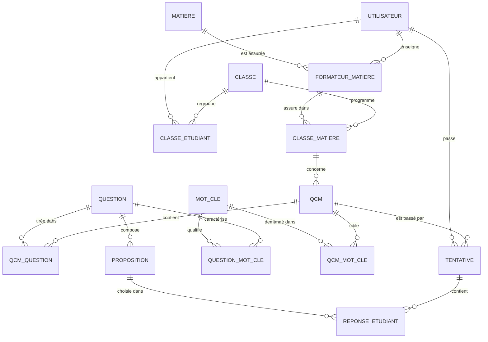
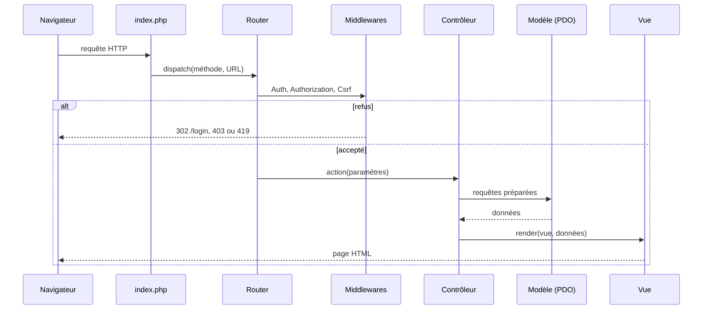
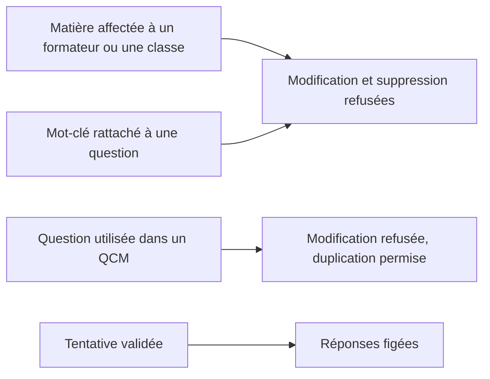

# Diagrammes

Les blocs ci-dessous sont en Mermaid : ils s'affichent sur GitHub, GitLab et dans VS Code avec l'extension « Markdown Preview Mermaid Support ».

## Modèle de données

## Parcours d'une requête

## Règles de verrouillage

